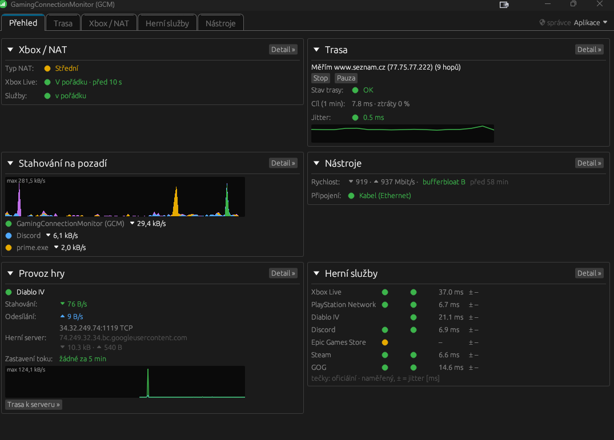
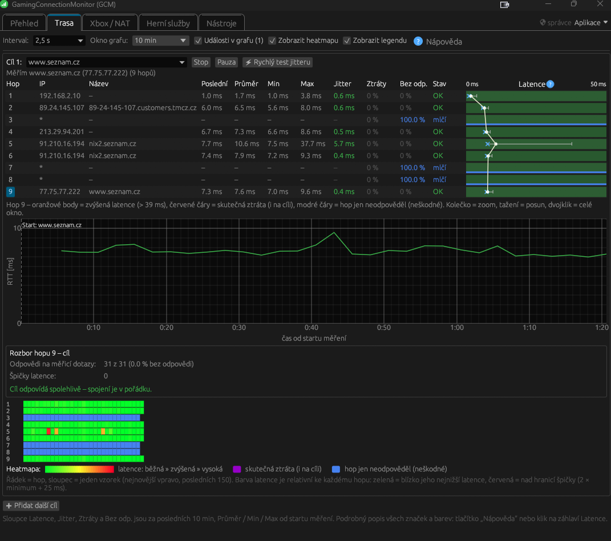

<h1 align="center">GamingConnectionMonitor (GCM)</h1>

**English** · [Česky](#česky)

A Windows desktop app for gamers that monitors connection quality:

- **Route** – continuous latency, jitter and packet-loss measurement on every router (hop) on the way to a target, a graph over time and a plain-language analysis of where the problem is (at your end, at your ISP, or at the game server).
- **Game services** – official status of games and platforms (Xbox Live, PlayStation Network, Epic Games, Riot Games, EVE Online, Discord…) plus your own reachability checks; games are added by searching ready-made profiles.
- **Xbox / NAT** – NAT type, UPnP, Teredo and the Windows services needed to play through the Xbox app.
- **Background downloads** – which programs and Windows services (Windows Update, Microsoft Store, Steam…) are downloading right now, how much and from which server, notifications while you play and an optional limit for Windows downloads during a game.
- **Game traffic** – data transfer of a running game, the game server, flow stalls and a comparison with the measured route.
- **Tools** – speed test with bufferbloat grade, quick DNS check and repair, DNS outage monitoring, link / Wi-Fi status, network settings and public IP history.

The tray icon shows the state of your network (green / orange / red) and the Ctrl+Alt+G shortcut shows or hides the app window.

Available in English, Czech and Slovak.

## Screenshots

## Download

**[Download GCM (ZIP, latest)](https://github.com/AlchKosac/GCM/releases/latest/download/GCM-win64.zip)** – unzip and run `gcm.exe` from the "GCM - GamingConnectionMonitor" folder, no installation needed (Windows 10 / 11). All versions and release notes are in [Releases](../../releases). The app offers new versions by itself (automatic update).

On first start Windows SmartScreen may show a warning (the app is not code-signed yet) – choose "More info" › "Run anyway".
Settings and measured data are stored in `%APPDATA%\GCM`; nothing is created next to `gcm.exe`, so you can move the folder anywhere.

## What is in this repository

| Folder | Content |
|---|---|
| `profiles/games.json` | profiles of games and services – where the app takes the official status from, what it measures and why, plus a list of known games. The app downloads it once a day, so new games and fixes arrive without a new app version. |
| `lang/*.json` | translations into further languages |
| [Releases](../../releases) | the `gcm.exe` binaries |

The source code of the app is not in this repository.

## Feedback

Questions, ideas and experiences: [Discussions](../../discussions). Bugs and specific problems: [Issues](../../issues). News and community: [Discord](https://discord.gg/d6a4rkB666).

The app is free. Author: Kosáč.

---

## Česky

Desktopová aplikace pro hráče na Windows, která hlídá kvalitu připojení k hrám:

- **Trasa** – průběžné měření latence, jitteru a ztrát na každém routeru (hopu) cesty k cíli, graf v čase a srozumitelný rozbor, kde je problém (u vás, u operátora, nebo u herního serveru).
- **Herní služby** – oficiální stav her a platforem (Xbox Live, PlayStation Network, Epic Games, Riot Games, EVE Online, Discord…) a vlastní měření dostupnosti; hry se přidávají vyhledáváním z připravených profilů.
- **Xbox / NAT** – typ NAT, UPnP, Teredo a služby Windows potřebné pro hraní přes Xbox aplikaci.
- **Stahování na pozadí** – které programy a služby Windows (Windows Update, Microsoft Store, Steam…) právě stahují, kolik a z jakého serveru, upozornění při hře a volitelné omezení rychlosti stahování Windows po dobu hry.
- **Provoz hry** – přenos dat spuštěné hry, herní server, zastavení toku a porovnání s měřenou trasou.
- **Nástroje** – test rychlosti s bufferbloatem, rychlá kontrola a oprava DNS, hlídání výpadků DNS, stav linky, nastavení sítě a veřejná IP s historií.

Ikona v oznamovací oblasti ukazuje stav sítě (zelená / oranžová / červená) a klávesová zkratka Ctrl+Alt+G zobrazí nebo schová okno aplikace.

Aplikace je v angličtině, češtině a slovenštině.

### Ukázky

### Stažení

**[⬇ Stáhnout GCM (ZIP, nejnovější verze)](https://github.com/AlchKosac/GCM/releases/latest/download/GCM-win64.zip)** – rozbalte a spusťte `gcm.exe` ze složky „GCM - GamingConnectionMonitor“, nic se neinstaluje (Windows 10 / 11). Přehled verzí a novinek je v sekci [Releases](../../releases). Další verze aplikace nabídne sama (automatická aktualizace).

Při prvním spuštění může Windows zobrazit varování SmartScreen (aplikace zatím není digitálně podepsaná) – zvolte „Další informace“ › „Přesto spustit“.
Nastavení a naměřená data se ukládají do `%APPDATA%\GCM` – vedle `gcm.exe` aplikace nic nevytváří, složku můžete přesunout kamkoli.

### Co je v tomto repozitáři

| Složka | Obsah |
|---|---|
| `profiles/games.json` | profily her a služeb – odkud aplikace bere oficiální stav, co měří a proč, a seznam známých her. Aplikace si je jednou denně stáhne, takže nové hry a opravy přibývají bez nové verze aplikace. |
| `lang/*.json` | překlady do dalších jazyků |
| [Releases](../../releases) | spustitelné `gcm.exe` |

Zdrojový kód aplikace zde není.

### Zpětná vazba

Dotazy, nápady a zkušenosti: [Discussions](../../discussions). Chyby a konkrétní problémy: [Issues](../../issues). Novinky a komunita: [Discord GuildAgenda](https://discord.gg/d6a4rkB666).

Aplikace je zdarma. Autor: Kosáč.
